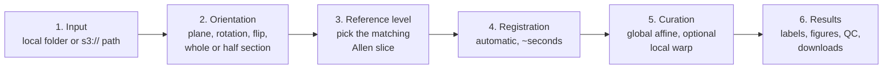

# MACAT: MERFISH Allen CCF Alignment Tool

What changed in each version: [`CHANGELOG.md`](CHANGELOG.md).

## Scope

MACAT aligns MERFISH mouse-brain sections to the Allen Mouse Brain Common
Coordinate Framework (CCF) and labels every cell with its Allen region. It runs
as a local web app: you pick a section, confirm its orientation and atlas level,
let it register automatically, refine the fit by eye, and download the results.


*The six steps, from creating a job to reviewing results
([MP4, sharper](media/MACAT_tutorial_EN.mp4)). Tutorial movie powered by
[screen-recording-gif-tutorial](https://github.com/greengarden0925/screen-recording-gif-tutorial).*

**It supports:**

- coronal and sagittal sections, whole sections and coronal hemisections;
- experiments in a local folder or on Amazon S3;
- a DAPI, cell-density or marker-gene background for checking the fit;
- per-cell Allen labels, region polygons, figures and expression QC against the
  Allen Brain Cell Atlas.

**It does not:**

- align other species, or 3D volumes;
- prove that an alignment is anatomically correct. The QC supports a fit; it
  does not certify it ([`docs/interpreting_results.md`](docs/interpreting_results.md)).

## Install

**Requirements:** Python 3.11, about 2 GB of disk (plus the Allen atlas, about
600 MB, downloaded on first use) and 8 GB of RAM. No GPU and no Node.js.
Building the Allen reference files once (below) needs more: about 10 GB of
temporary disk and 22 GB of RAM.

**Tested on Linux, Windows and macOS (Apple Silicon).**

### From PyPI

> **Not released yet.** Once released:

```bash
pip install macat
```

### From the repository (until the release)

```bash
git clone https://github.com/Vizgen/MACAT.git
cd MACAT
```

Then create the Python environment, with **one** of the three options below.

[uv](https://docs.astral.sh/uv/) is the quickest, and installs Python 3.11 for
you if you don't have it. Install uv first (one command, see its
[installation page](https://docs.astral.sh/uv/getting-started/installation/)),
then:

```bash
uv venv --python 3.11
source .venv/bin/activate          # Windows: .venv\Scripts\activate
uv pip install -r requirements-web.txt
```

**or** conda:

```bash
conda env create -f environment.yml
conda activate macat
```

**or** plain pip, with Python 3.11 already installed:

```bash
python3.11 -m venv .venv
source .venv/bin/activate          # Windows: .venv\Scripts\activate
pip install -r requirements-web.txt
```

### Build the Allen reference files (required, once)

MACAT compares your sections with tables derived from the Allen Brain Cell
Atlas. Their licence (CC BY-NC 4.0) permits noncommercial use only, so they are
not shipped with MACAT: you build them yourself from Allen's public release. It
downloads about 9.2 GB, needs about 22 GB of RAM at its peak, and takes about
15 minutes. Until they are built, MACAT warns at startup and registration stops
with a message naming the missing file.

With conda:

```bash
conda env create -f environment_allen_reference.yml   # a build-only environment
conda activate allen_reference
```

**or** with uv (or pip, with Python 3.10 installed):

```bash
uv venv --python 3.10 .venv-allen-reference          # a build-only environment
source .venv-allen-reference/bin/activate            # Windows: .venv-allen-reference\Scripts\activate
uv pip install -r requirements-allen-reference.txt
```

Then build:

```bash
python scripts/data/fetch_allen_sources.py
python scripts/data/fetch_abc_reference.py
python scripts/data/fetch_abc_section_reference.py
```

Details, and checksums to confirm the build:
[`data/reference/README.md`](data/reference/README.md), "Rebuilding them".
Then switch back to MACAT's environment.

### Start it

From the repository root, with the environment active:

```bash
python -m uvicorn web.server:app --host 127.0.0.1 --port 8700
```

Open <http://127.0.0.1:8700> in a browser. The first registration downloads the
Allen atlas to `~/.brainglobe` (about 600 MB).

### Optional: experiments on S3

Install the [AWS CLI](https://aws.amazon.com/cli/) and give it credentials that
can read your bucket (`aws configure`, or `AWS_PROFILE`). Then paste an `s3://`
path to a region folder in step 1, for example
`s3://<your-bucket>/<experiment>/region_R1/`.

### Settings

All optional, set as environment variables before starting:

| variable | default | what it changes |
| --- | --- | --- |
| `MACAT_DATA_DIR` | none | your data folder (see Usage); overrides the one set in step 1 |
| `ALLEN_OUT_ROOT` | `pipeline_output/` | where jobs and their outputs are stored |
| `ALLEN_S3_CACHE` | `data/s3_cache/` | where files fetched from S3 are kept |
| `ALLEN_ATLAS_RES_UM`, `ALLEN_PLANE_DX_UM` | `25` | atlas resolution in µm (`25` or `50`); set both to the same value |

### Troubleshooting

- **`address already in use`** (on Windows, `[Errno 10048] ... only one usage of
  each socket address`): the port is taken, often by a server you already
  started, or by VS Code forwarding a port from a remote machine. Open
  <http://127.0.0.1:8700> to check, or start on another port (`--port 18700`).
- **`ModuleNotFoundError`:** the environment is not active. Activate it and start
  again.
- **`Could not import module "web.server"`:** start from the repository root.
- **The page looks old after an update:** hard-reload the browser (Ctrl-Shift-R;
  Cmd-Shift-R on macOS).
- **Windows, folder synced by OneDrive:** keep the outputs out of it
  (`set ALLEN_OUT_ROOT=C:\MACAT_output` before starting), or saves can fail or
  slow down while OneDrive syncs.

More, including S3 errors and remote machines:
[`docs/troubleshooting.md`](docs/troubleshooting.md).

## Usage

### Workflow



Every job is saved as you go and can be resumed from step 1's job list.

### Your data folder

Keep your experiments as MERSCOPE writes them, `<experiment>/region_*/`, with
each region's `images/` folder inside it, all under one folder: on your computer,
or an `s3://` prefix. Set that folder once in step 1 (**Data folder → Set…**), and
every region appears under **Your sections**. MACAT remembers it, and scans it
only when you set it or press **Rescan**. Exactly that depth is scanned: region
folders directly inside each experiment folder. You can always paste a single
region folder into **Experiment folder** instead. The data folder can only be
set on the computer MACAT runs on (or through an SSH tunnel to it).

A region folder can also carry its known answers in an `expected.json`. MACAT
then shows the correct atlas level beside the section, pre-fills step 2 and
opens step 3 on that level. Format:
[`docs/allen_annotated_data.md`](docs/allen_annotated_data.md#answer-keys-expectedjson).

### No data yet? Try an example

- **Vizgen's MERFISH mouse-brain showcase** from the
  [Vizgen website](https://info.vizgen.com/mouse-brain-map). Put each slice in
  your data folder as `<experiment>/region_*/`, keeping its `images/` folder
  inside. MACAT reads the files by their exact names (see Inputs below): if the
  download adds a suffix, such as `cell_metadata_S1R1.csv`, rename it to
  `cell_metadata.csv`, and likewise for the others.
- **Allen annotated data:** 12 published sections (whole coronal, coronal
  hemisection and sagittal) whose correct orientation, level and per-cell
  regions are known, so you can check MACAT's answers. Build them, then set your
  data folder to their `sections` folder. Download links and build commands:
  [`docs/allen_annotated_data.md`](docs/allen_annotated_data.md).

### Inputs

A MERFISH region folder (local or S3):

| file | needed | used for |
| --- | --- | --- |
| `cell_metadata.csv` | **required** | cell positions (`EntityID`, `center_x`, `center_y`, in µm) |
| `cell_by_gene.csv` | **required** | expression QC and the marker-gene background |
| `images/mosaic_DAPI_z3.tif` + `images/micron_to_mosaic_pixel_transform.csv` | optional | the DAPI background; without them, cell density is shown |
| `detected_transcripts.parquet` (or `.csv`) | optional | the transcript-density background |

### Outputs

Each job's files are in `<output root>/jobs/<job id>/outputs/`. Step 6's
**Download .zip** collects them, with a `manifest.json`, into one archive:

| in the archive | content |
| --- | --- |
| `per_cell/` | every cell with its Allen region: curated and automatic |
| `geometry_curated/` | Allen region polygons in the section's own coordinates (GeoJSON) |
| `figures_curated/`, `figures_auto/` | regions over the background, cells coloured by region |
| `region_tables_*/` | per-region cell counts, region × gene counts, per-region QC |
| `hex_bin_qc_*/` | the spatial QC map and its per-bin table |
| `merscope_vizualizer_*/` | cell → Allen region, ready to import into the MERSCOPE Vizualizer |

What the coverage, correlation and QC numbers mean, and the per-cell table's
columns: [`docs/interpreting_results.md`](docs/interpreting_results.md).

## More documentation

- [`docs/architecture.md`](docs/architecture.md): how the tool is put together.
- [`docs/troubleshooting.md`](docs/troubleshooting.md): problems and fixes.
- [`docs/allen_annotated_data.md`](docs/allen_annotated_data.md): downloading the
  Allen annotated data.
- [`docs/development_testing.md`](docs/development_testing.md): running the
  tests and working on the code.
- [`data/reference/README.md`](data/reference/README.md): the Allen reference
  files and how to rebuild them.

## License and contributing

The code is licensed under the [Apache License, Version 2.0](LICENSE.md). The
Allen-derived data is **not**: it is under CC BY-NC 4.0 and the Allen Institute
Terms of Use, noncommercial use only. See [`NOTICE`](NOTICE).

Contributions follow [`CONTRIBUTING.md`](CONTRIBUTING.md) and the
[Code of Conduct](CODE_OF_CONDUCT.md).
